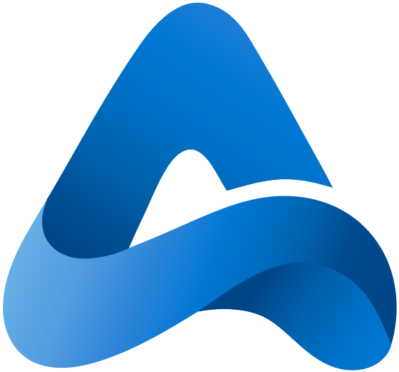

# Azure Informatique

**L’informatique accessible à tous.**

Accompagnement informatique bénévole et gratuit autour du logiciel libre, 
pour les particuliers et les professionnels, depuis Mulhouse, partout en Alsace et à distance.

 

---

### Notre démarche

Nous partageons bénévolement notre expérience du logiciel libre : des solutions qui vous appartiennent, hébergées où vous le décidez, plutôt que des outils propriétaires coûteux et bien souvent hébergés à l’étranger. Un regard honnête, des outils libres et rien d’imposé — sans fermer la porte au propriétaire quand un besoin précis le justifie.

### Un accompagnement à chaque étape

| Service | En bref |
|---|---|
| **Audit** | Un état des lieux clair de votre parc ou de vos usages, sans jargon. |
| **Migration** | Passer d’une solution propriétaire à un équivalent libre, en limitant les ruptures. |
| **Déploiement et intégration** | Des outils robustes, connectés à votre infrastructure existante. |
| **Prise en main** | Rendre vos équipes ou votre foyer autonomes sur les outils installés. |
| **Espace privé chez vous** | Votre propre Nextcloud, pour vos fichiers, photos et agendas. |
| **Domotique libre** | Une maison connectée qui vous appartient, sans compte tiers obligatoire. |

### Le cloud libre, maîtrisé

Nextcloud est l’alternative libre que nous connaissons le mieux : plus de cinq ans d’expérience, au quotidien. Fichiers et partages, visioconférences avec Talk, bureautique en ligne (ONLYOFFICE ou Collabora), agendas, contacts et courriel, assistant d’IA local, connexion unique, double authentification et sauvegardes chiffrées hors site.

Nous ne sommes ni rémunérés ni affiliés à Nextcloud GmbH : nous recommandons cette solution car nous l’utilisons.

### Pourquoi le libre

- **Indépendance** — pas de dépendance à un éditeur qui change ses prix ou ses règles du jour au lendemain.
- **Vos données, chez vous** — hébergées là où vous le décidez, sans qu’un tiers vous l’impose.
- **Pas de licence imposée** — ni redevance ni abonnement, quel que soit le nombre de postes.
- **Code auditable** — chacun peut vérifier ce que fait le logiciel.

### À découvrir sur notre site

- [**Actualités**](https://azure-informatique.fr/actualites/) — logiciel libre, cybersécurité et auto-hébergement : des analyses sourcées chaque jour
- [**Alternatives**](https://azure-informatique.fr/alternatives/) — les équivalents libres de vos logiciels du quotidien, licences vérifiées
- [**Souveraineté**](https://azure-informatique.fr/souverainete/) — pourquoi quitter les GAFAM, faits datés et sourcés à l’appui
- [**Passer à Linux**](https://azure-informatique.fr/passer-a-linux/) — quitter Windows et redonner vie à votre ordinateur avec Zorin OS
- [**Glossaire**](https://azure-informatique.fr/glossaire/) — le vocabulaire du numérique, expliqué simplement

---

**Accompagnement entièrement gratuit, sans contrepartie.** 
Si notre travail vous est utile, vous pouvez [nous soutenir](https://azure-informatique.fr/nous-soutenir/) ou simplement nous faire connaître.

Conçu et hébergé en Alsace

